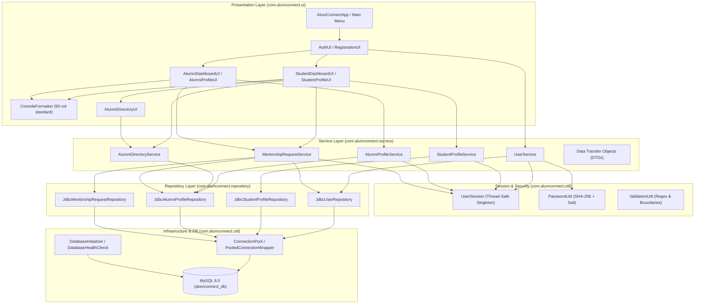
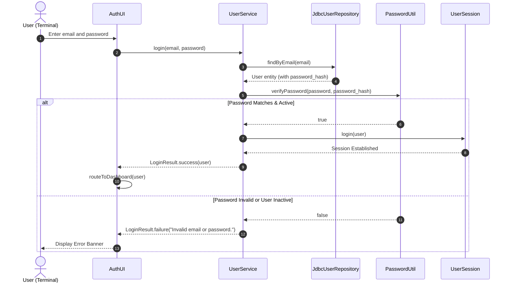
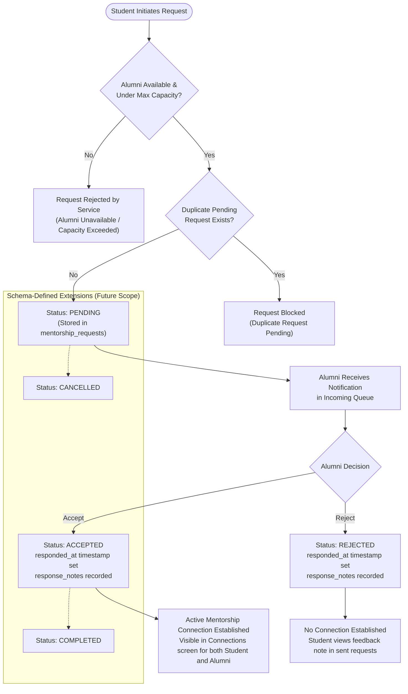
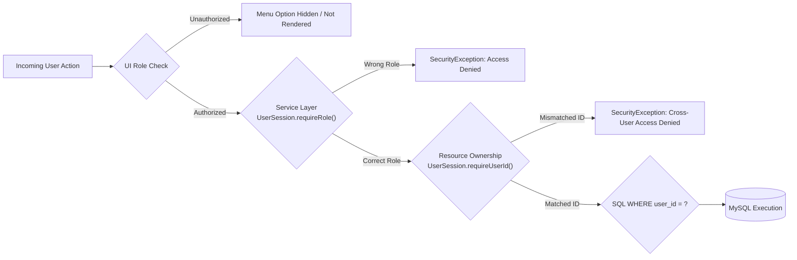

# AlumConnect — System Architecture & Feature Workflow Documentation

> Technical architecture reference, layer responsibilities, data flow, role-based access control (RBAC), and feature workflows for the **AlumConnect** platform.

---

## 1. System Architecture Overview

**AlumConnect** is built around a classic, robust **Layered Architecture (Separation of Concerns)**. The platform strictly decouples presentation, domain logic, data access, and database infrastructure to guarantee testability, maintainability, and enterprise-grade security.

### Core Architectural Principles:
1. **Clean Separation of Concerns:** The presentation layer performs no business logic or SQL queries; the service layer contains no console/terminal formatting code; repositories contain only data access logic.
2. **Defensive Security & RBAC:** Authorization is verified at multiple levels (defense-in-depth). UI menus conceal unauthorized options, while service methods independently assert active session roles and resource ownership.
3. **Pure JDBC with Connection Pooling:** All database interactions utilize pure Java Database Connectivity (JDBC) using parameterized `PreparedStatement` queries (`?`) managed through a thread-safe connection pool (`ConnectionPool`).
4. **Data Isolation:** Private profile details and mentorship queues are strictly isolated by authenticated user IDs (`WHERE user_id = ?` and `requireUserId`).

---

## 2. Layer Responsibilities & Data Movement



### 2.1. Model Layer (`com.alumconnect.model`)
* **Responsibilities:** Pure domain entities representing core entities in the application.
* **Key Classes:**
  * `User` (abstract base): Encapsulates `id`, `email`, `passwordHash`, `fullName`, `role` (`STUDENT`, `ALUMNI`, `ADMIN`), and timestamps.
  * `Student` (extends `User`): Academic details (`department`, `graduationYear`, `currentSemester`, `enrollmentNumber`, `skills`, `interests`, `linkedinUrl`, `githubUrl`).
  * `Alumni` (extends `User`): Professional details (`currentCompany`, `currentRole`, `industry`, `yearsOfExperience`, `expertiseAreas`, `isAvailableForMentorship`, `maxMentees`).
  * `MentorshipRequest`: Mirrors `mentorship_requests` table with request metadata and join attributes for display cards.
  * `Role`: Enumeration defining platform roles (`STUDENT`, `ALUMNI`, `ADMIN`).
  * `MentorshipStatus`: Enumeration defining lifecycle states (`PENDING`, `ACCEPTED`, `REJECTED`, `COMPLETED`, `CANCELLED`).

### 2.2. Repository / JDBC Layer (`com.alumconnect.repository`)
* **Responsibilities:** Executes parameterized SQL queries, maps `ResultSet` rows to domain entities, handles database exceptions safely, and manages transactions.
* **Key Classes:** `JdbcUserRepository`, `JdbcStudentProfileRepository`, `JdbcAlumniProfileRepository`, `JdbcMentorshipRequestRepository`.
* **Security & Reliability:**
  * Uses `PreparedStatement` with `?` markers exclusively (immune to SQL injection).
  * Always wraps connections, statements, and result sets in `try-with-resources`.
  * Rolls back multi-step transactions on failure (`connection.rollback()`).

### 2.3. Service Layer (`com.alumconnect.service`)
* **Responsibilities:** Implements all core business rules, RBAC authorization preconditions, password hashing, and input validation.
* **Key Classes:** `UserService`, `StudentProfileService`, `AlumniProfileService`, `AlumniDirectoryService`, `MentorshipRequestService`.
* **Communication via DTOs:** Uses specialized result and request objects (`LoginResult`, `RegistrationResult`, `StudentProfileResult`, `AlumniProfileResult`, `AlumniDirectoryResult`, `MentorshipRequestResult`) to communicate with the UI without exposing internal repository exceptions.

### 2.4. Presentation Layer (`com.alumconnect.ui`)
* **Responsibilities:** Coordinates user console interaction, renders menus, captures input via `Scanner`, validates basic input formats, and displays structured output tables.
* **Key Classes:** `AlumConnectApp`, `ConsoleFormatter`, `AuthUI`, `RegistrationUI`, `StudentDashboardUI`, `StudentProfileUI`, `AlumniDashboardUI`, `AlumniProfileUI`, `AlumniDirectoryUI`.
* **Formatting:** `ConsoleFormatter` enforces a consistent 50-character visual layout, headers, dividers, and status tags (`[SUCCESS]`, `[ERROR]`, `[INFO]`).

### 2.5. Database & Infrastructure Layer (`com.alumconnect.util`)
* **Responsibilities:** Thread-safe connection pooling, connection wrapper recycling, and database bootstrap.
* **Key Classes:** `ConnectionPool` (manages active and idle pool connections), `PooledConnectionWrapper` (re-routes `close()` back to the pool), `DatabaseInitializer` (runs `schema.sql`), and `DatabaseHealthCheck`.

### 2.6. End-to-End Data Flow

```text
[ Console Terminal Input ]
           |
           v
[ Presentation Layer (UI) ]
     Validates input format via ValidationUtil; packages inputs into DTO
           |
           v
[ Service Layer ]
     Checks UserSession.requireRole() and UserSession.requireUserId();
     Applies domain logic (e.g. check alumni availability, hash passwords)
           |
           v
[ Repository Layer (JDBC) ]
     Acquires Connection from ConnectionPool;
     Prepares SQL with '?' markers; executes query/update;
     Maps ResultSet -> Domain Model POJO; returns Connection to pool
           |
           v
[ MySQL Database (alumconnect_db) ]
     Persists row with ACID guarantees & foreign key constraints
```

---

## 3. Authentication & Session-Handling Flow

The session lifecycle is maintained in-memory through the thread-safe singleton [`UserSession`](file:///c:/coding/AlumConnect/AlumConnect/src/main/java/com/alumconnect/util/UserSession.java):



1. **Password Security:** Passwords entered during registration are salted and hashed via `PasswordUtil.hashPassword(rawPassword)` using SHA-256 before insertion. Raw passwords are never stored in memory models or repository logs.
2. **Session Storage:** Upon successful verification, `UserSession.getInstance().login(user)` stores the active `User` in a `volatile` reference.
3. **Session Interrogation:** Downstream services invoke `UserSession.getInstance().getCurrentUser()` or `getCurrentRole()` to authenticate requests.
4. **Logout Invalidation:** When the user selects `[9] Logout` on either dashboard, `UserSession.getInstance().logout()` clears the active session reference, immediately blocking any subsequent operations.

---

## 4. Implemented Student Workflows

All student workflows are accessible from [`StudentDashboardUI.java`](file:///c:/coding/AlumConnect/AlumConnect/src/main/java/com/alumconnect/ui/StudentDashboardUI.java) and secured by `UserSession.requireRole(Role.STUDENT)`:

### 4.1. Registration & Login
* **Registration:** Student selects `[2] Register New Account` on the main menu, chooses role `Student`, and enters name, email, password, department, and graduation year. `UserService.register()` creates the `users` and `student_profiles` rows.
* **Login:** Student enters credentials, receives authentication confirmation, and is routed to the Student Dashboard.

### 4.2. Profile Management
* **View Profile:** Displays personal academic record (degree, department, semester, enrollment number, graduation year, bio, skills, interests, LinkedIn, GitHub).
* **Create/Update Profile:** Student updates semester, bio, skills, interests, or profile links. `StudentProfileService.updateProfile()` asserts `UserSession.requireUserId(student.getId())` to ensure students cannot tamper with other students' data.

### 4.3. Alumni Discovery & Filtering
* **Browse Directory (`[2]`):** Retrieves all registered alumni profiles via `AlumniDirectoryService.getAlumniDirectory()`, showing cards with company, role, experience, and mentorship availability.
* **Search Alumni (`[3]`):** Performs keyword search against alumni name, current company, role, industry, or expertise areas (`AlumniDirectoryService.searchAlumni(query)`).
* **Filter Alumni (`[4]`):** Applies structured filtering via `AlumniFilterCriteria` (by department, industry, and minimum years of experience).

### 4.4. Mentorship Requests & Connections
* **Sending Mentorship Requests:** When inspecting an alumnus card, a student enters topic and cover message. `MentorshipRequestService.sendRequest(alumniId, topic, message)` validates that the alumnus is available, not at max capacity, and that no duplicate pending request exists.
* **Checking Request Status (`[5]`):** Lists all sent requests with real-time status indicators (`PENDING`, `ACCEPTED`, `REJECTED`) and timestamps.
* **Viewing Accepted Connections (`[6]`):** Displays confirmed mentors, their verified contact details, email addresses, and LinkedIn profiles.

---

## 5. Implemented Alumni Workflows

All alumni workflows are accessible from [`AlumniDashboardUI.java`](file:///c:/coding/AlumConnect/AlumConnect/src/main/java/com/alumconnect/ui/AlumniDashboardUI.java) and secured by `UserSession.requireRole(Role.ALUMNI)`:

### 5.1. Registration & Login
* **Registration:** Selects role `Alumni`, provides contact info, department, graduation year, company, role, and industry.
* **Login:** Authenticates and lands on the Alumni Dashboard.

### 5.2. Profile & Mentorship Capacity Management
* **View/Update Profile:** Manages current employer, role, industry, years of experience, expertise keywords, and bio.
* **Availability Toggle:** Toggles `is_available_for_mentorship` on/off to pause incoming requests when busy.
* **Mentee Capacity:** Updates `max_mentees` (default: 3) to control active mentorship bandwidth.

### 5.3. Managing Incoming Mentorship Requests
* **View Incoming Requests (`[2]`):** Queries `MentorshipRequestService.getReceivedRequests(alumniId)`. Displays requesting student's name, degree, department, graduation year, request topic, and personal message.
* **Accepting Requests:** Alumnus approves a pending request and attaches optional notes (e.g. meeting details). Status transitions to `ACCEPTED`.
* **Rejecting Requests:** Alumnus declines a request with constructive feedback notes. Status transitions to `REJECTED`.
* **Ownership Enforcement:** Service methods assert `request.getAlumniId() == sessionAlumniId`; alumni are barred from viewing or acting upon requests directed to peers.

### 5.4. Viewing Mentorship Connections (`[3]`)
* Retrieves all confirmed mentees (`status = 'ACCEPTED'`), showing student contact information, department, and semester.

---

## 6. Mentorship Request Lifecycle



### Lifecycle Rules Enforced in Code:
1. **Self-Mentorship Prevention:** `studentId != alumniId` (enforced in `ValidationUtil` and SQL constraint `chk_distinct_participants`).
2. **Availability Check:** Alumni with `is_available_for_mentorship = false` cannot receive new requests.
3. **Capacity Check:** If an alumnus already has active accepted requests equal to or exceeding `max_mentees`, new requests are rejected.
4. **Immutability of Terminal States:** Once a request is `ACCEPTED` or `REJECTED`, its status cannot be reversed or overwritten.

---

## 7. Role-Based Access Control (RBAC) Architecture

AlumConnect employs a **Defense-in-Depth** security strategy:



| Security Dimension | Implementation Mechanism | Evidence Class & Method |
| :--- | :--- | :--- |
| **Identity Identification** | In-memory singleton stores authenticated user object upon login. | `UserSession.getInstance().getCurrentUser()` |
| **Role Maintenance** | Strongly typed `Role` enum (`STUDENT`, `ALUMNI`, `ADMIN`) attached to the `User` model. | `User.getRole()` & `UserSession.getCurrentRole()` |
| **Service-Layer Guard** | Service methods assert role requirements prior to executing business operations. | `UserSession.requireStudent()`, `UserSession.requireAlumni()` |
| **Ownership Protection** | Verifies that the requested resource ID belongs to the authenticated user ID. | `UserSession.requireUserId(int expectedUserId)` |
| **SQL Row Isolation** | Update and delete statements enforce explicit parameter markers for user identity. | `JdbcStudentProfileRepository.update(profile)` (`WHERE user_id = ?`) |
| **UI Presentation Gating**| Dynamic routing directs users strictly to role-specific dashboard classes. | `AuthUI.routeToDashboard(User user)` |

---

## 8. Architectural Evidence & Implementation Mapping

| Architectural Responsibility | Core Classes | Primary Methods |
| :--- | :--- | :--- |
| **Authentication & Registration** | `UserService`, `AuthUI`, `RegistrationUI` | `login()`, `register()`, `promptAndLogin()` |
| **Session & RBAC** | `UserSession`, `PasswordUtil` | `login()`, `logout()`, `requireRole()`, `requireUserId()` |
| **Student Profiles** | `StudentProfileService`, `StudentProfileUI`, `JdbcStudentProfileRepository` | `getProfile()`, `updateProfile()`, `save()` |
| **Alumni Profiles** | `AlumniProfileService`, `AlumniProfileUI`, `JdbcAlumniProfileRepository` | `getProfile()`, `updateProfile()`, `save()` |
| **Directory & Search** | `AlumniDirectoryService`, `AlumniDirectoryUI` | `getAlumniDirectory()`, `searchAlumni()`, `filterAlumni()` |
| **Mentorship Requests** | `MentorshipRequestService`, `JdbcMentorshipRequestRepository` | `sendRequest()`, `getReceivedRequests()`, `acceptRequest()`, `rejectRequest()` |
| **Mentorship Connections** | `MentorshipRequestService`, `StudentDashboardUI`, `AlumniDashboardUI` | `getConnectionsForStudent()`, `getConnectionsForAlumni()` |
| **Connection Pooling & DDL** | `ConnectionPool`, `DatabaseInitializer`, `DatabaseHealthCheck` | `acquire()`, `release()`, `initializeDatabase()` |

---

## 9. Incomplete or Unverified Functionality

To maintain 100% technical accuracy, the following boundaries are documented:
* **`Role.ADMIN`:** Modeled in the `Role` enum and `users` table schema, but administrative dashboard UI and admin services are not yet implemented.
* **`COMPLETED` & `CANCELLED` Mentorship Transitions:** The database schema and `MentorshipStatus` enum support these states, but no console menu options currently trigger them.
* **Real-time Notifications:** Mentorship updates are retrieved upon visiting the dashboard rather than via asynchronous push notifications.
