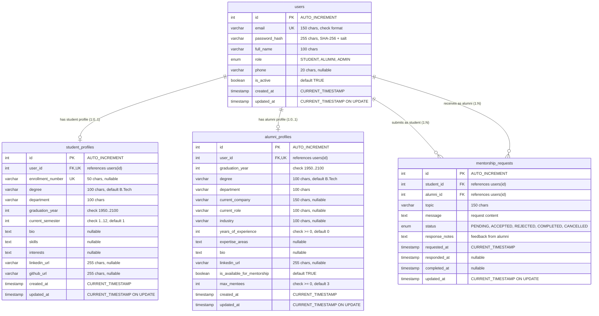

# AlumConnect — Database Design & Schema Documentation

> Comprehensive documentation of the relational database architecture, tables, foreign keys, constraints, and entity relationships for the **AlumConnect** platform.

---

## 1. Database Overview

* **Database Name:** `alumconnect_db`
* **Default Character Set:** `utf8mb4`
* **Collation:** `utf8mb4_unicode_ci`
* **Storage Engine:** MySQL `InnoDB` (supports ACID transactions, row-level locking, foreign key constraints)
* **Configuration Source:** [`src/main/resources/application.properties`](file:///c:/coding/AlumConnect/AlumConnect/src/main/resources/application.properties)
* **DDL Definition File:** [`schema.sql`](file:///c:/coding/AlumConnect/AlumConnect/schema.sql) and [`src/main/resources/schema.sql`](file:///c:/coding/AlumConnect/AlumConnect/src/main/resources/schema.sql)
* **Initialization Mechanism:** Executed programmatically by [`DatabaseInitializer.java`](file:///c:/coding/AlumConnect/AlumConnect/src/main/java/com/alumconnect/util/DatabaseInitializer.java) on application boot.

---

## 2. Entity-Relationship (ER) Diagram

The diagram below reflects the exact schema defined in `schema.sql`:

---

## 3. Table Specifications

### 3.1. Table: `users`
The core authentication and account entity for all platform members.

| Column | Data Type | Nullable | Default | Description |
| :--- | :--- | :---: | :--- | :--- |
| `id` | `INT` | No | `AUTO_INCREMENT` | Surrogate primary key. |
| `email` | `VARCHAR(150)` | No | *None* | Unique login identifier. Validated by format constraint. |
| `password_hash` | `VARCHAR(255)` | No | *None* | Pre-computed SHA-256 salted hash. Raw passwords never stored. |
| `full_name` | `VARCHAR(100)` | No | *None* | User display name. |
| `role` | `ENUM('STUDENT','ALUMNI','ADMIN')` | No | *None* | User authorization role. |
| `phone` | `VARCHAR(20)` | Yes | `NULL` | Optional contact telephone number. |
| `is_active` | `BOOLEAN` | No | `TRUE` | Account status flag for active access. |
| `created_at` | `TIMESTAMP` | No | `CURRENT_TIMESTAMP` | Account creation timestamp. |
| `updated_at` | `TIMESTAMP` | No | `CURRENT_TIMESTAMP ON UPDATE CURRENT_TIMESTAMP` | Last profile update timestamp. |

* **Primary Key:** `PRIMARY KEY (id)`
* **Unique Constraints:** `UNIQUE KEY (email)`
* **Check Constraints:** `CONSTRAINT chk_email_format CHECK (email LIKE '%_@__%.__%')`
* **Indexes:**
  * `idx_users_role ON users(role)` — accelerates role-filtered queries.
  * `idx_users_email ON users(email)` — ensures fast lookup on login.

---

### 3.2. Table: `student_profiles`
Maintains academic records and student-specific attributes.

| Column | Data Type | Nullable | Default | Description |
| :--- | :--- | :---: | :--- | :--- |
| `id` | `INT` | No | `AUTO_INCREMENT` | Surrogate primary key. |
| `user_id` | `INT` | No | *None* | Foreign key to `users(id)`. Unique (1-to-1 relationship). |
| `enrollment_number` | `VARCHAR(50)` | Yes | `NULL` | Institutional enrollment/roll number. Unique when provided. |
| `degree` | `VARCHAR(100)` | No | `'Bachelor of Technology'` | Academic degree name. |
| `department` | `VARCHAR(100)` | No | *None* | Department/Major (e.g., Computer Science). |
| `graduation_year` | `INT` | No | *None* | Expected or actual graduation year. |
| `current_semester` | `INT` | Yes | `1` | Current enrolled semester (1–12). |
| `bio` | `TEXT` | Yes | `NULL` | Student biography or career statement. |
| `skills` | `TEXT` | Yes | `NULL` | Technical and soft skills (comma-delimited or free text). |
| `interests` | `TEXT` | Yes | `NULL` | Career goals or research interests. |
| `linkedin_url` | `VARCHAR(255)` | Yes | `NULL` | Optional LinkedIn profile URL. |
| `github_url` | `VARCHAR(255)` | Yes | `NULL` | Optional GitHub profile URL. |
| `created_at` | `TIMESTAMP` | No | `CURRENT_TIMESTAMP` | Profile creation timestamp. |
| `updated_at` | `TIMESTAMP` | No | `CURRENT_TIMESTAMP ON UPDATE CURRENT_TIMESTAMP` | Last profile modification timestamp. |

* **Primary Key:** `PRIMARY KEY (id)`
* **Unique Constraints:**
  * `UNIQUE KEY (user_id)`
  * `UNIQUE KEY (enrollment_number)`
* **Foreign Key Constraints:**
  * `CONSTRAINT fk_student_user FOREIGN KEY (user_id) REFERENCES users(id) ON DELETE CASCADE ON UPDATE CASCADE`
* **Check Constraints:**
  * `CONSTRAINT chk_student_semester CHECK (current_semester >= 1 AND current_semester <= 12)`
  * `CONSTRAINT chk_student_grad_year CHECK (graduation_year >= 1950 AND graduation_year <= 2100)`
* **Indexes:**
  * `idx_student_department ON student_profiles(department)`
  * `idx_student_grad_year ON student_profiles(graduation_year)`

---

### 3.3. Table: `alumni_profiles`
Maintains professional career data and mentorship availability for graduated alumni.

| Column | Data Type | Nullable | Default | Description |
| :--- | :--- | :---: | :--- | :--- |
| `id` | `INT` | No | `AUTO_INCREMENT` | Surrogate primary key. |
| `user_id` | `INT` | No | *None* | Foreign key to `users(id)`. Unique (1-to-1 relationship). |
| `graduation_year` | `INT` | No | *None* | College graduation year. |
| `degree` | `VARCHAR(100)` | No | `'Bachelor of Technology'` | Conferred degree name. |
| `department` | `VARCHAR(100)` | No | *None* | Department/Major graduated from. |
| `current_company` | `VARCHAR(150)` | Yes | `NULL` | Current employer or company name. |
| `current_role` | `VARCHAR(100)` | Yes | `NULL` | Current professional job title. |
| `industry` | `VARCHAR(100)` | Yes | `NULL` | Industry sector (e.g., Technology, Finance, Healthcare). |
| `years_of_experience`| `INT` | Yes | `0` | Total professional experience in years. |
| `expertise_areas` | `TEXT` | Yes | `NULL` | Key technical and leadership competencies. |
| `bio` | `TEXT` | Yes | `NULL` | Professional biography. |
| `linkedin_url` | `VARCHAR(255)` | Yes | `NULL` | Verified LinkedIn profile link. |
| `is_available_for_mentorship` | `BOOLEAN` | No | `TRUE` | Global toggle controlling willingness to accept new mentees. |
| `max_mentees` | `INT` | No | `3` | Maximum concurrent mentees capacity. |
| `created_at` | `TIMESTAMP` | No | `CURRENT_TIMESTAMP` | Profile creation timestamp. |
| `updated_at` | `TIMESTAMP` | No | `CURRENT_TIMESTAMP ON UPDATE CURRENT_TIMESTAMP` | Last profile update timestamp. |

* **Primary Key:** `PRIMARY KEY (id)`
* **Unique Constraints:** `UNIQUE KEY (user_id)`
* **Foreign Key Constraints:**
  * `CONSTRAINT fk_alumni_user FOREIGN KEY (user_id) REFERENCES users(id) ON DELETE CASCADE ON UPDATE CASCADE`
* **Check Constraints:**
  * `CONSTRAINT chk_alumni_experience CHECK (years_of_experience >= 0)`
  * `CONSTRAINT chk_alumni_max_mentees CHECK (max_mentees >= 0)`
  * `CONSTRAINT chk_alumni_grad_year CHECK (graduation_year >= 1950 AND graduation_year <= 2100)`
* **Indexes:**
  * `idx_alumni_department ON alumni_profiles(department)` — directory filtering by department.
  * `idx_alumni_company ON alumni_profiles(current_company)` — search by company name.
  * `idx_alumni_industry ON alumni_profiles(industry)` — directory filtering by industry.
  * `idx_alumni_mentorship ON alumni_profiles(is_available_for_mentorship)` — quick filtering for active mentors.

---

### 3.4. Table: `mentorship_requests`
Manages formal student-to-alumni mentorship requests and their status transitions.

| Column | Data Type | Nullable | Default | Description |
| :--- | :--- | :---: | :--- | :--- |
| `id` | `INT` | No | `AUTO_INCREMENT` | Surrogate primary key. |
| `student_id` | `INT` | No | *None* | Foreign key to `users(id)` representing the requesting student. |
| `alumni_id` | `INT` | No | *None* | Foreign key to `users(id)` representing the targeted mentor. |
| `topic` | `VARCHAR(150)` | No | *None* | Subject matter of mentorship request (e.g. "Career Transition"). |
| `message` | `TEXT` | No | *None* | Detailed request context from student. |
| `status` | `ENUM('PENDING','ACCEPTED','REJECTED','COMPLETED','CANCELLED')` | No | `'PENDING'` | Current lifecycle status of the request. |
| `response_notes` | `TEXT` | Yes | `NULL` | Feedback notes provided by alumni on accept/reject. |
| `requested_at` | `TIMESTAMP` | No | `CURRENT_TIMESTAMP` | Submission timestamp. |
| `responded_at` | `TIMESTAMP` | Yes | `NULL` | Timestamp when alumnus accepted or rejected the request. |
| `completed_at` | `TIMESTAMP` | Yes | `NULL` | Timestamp when mentorship engagement concluded. |
| `updated_at` | `TIMESTAMP` | No | `CURRENT_TIMESTAMP ON UPDATE CURRENT_TIMESTAMP` | Last status modification timestamp. |

* **Primary Key:** `PRIMARY KEY (id)`
* **Foreign Key Constraints:**
  * `CONSTRAINT fk_mentorship_student FOREIGN KEY (student_id) REFERENCES users(id) ON DELETE CASCADE ON UPDATE CASCADE`
  * `CONSTRAINT fk_mentorship_alumni FOREIGN KEY (alumni_id) REFERENCES users(id) ON DELETE CASCADE ON UPDATE CASCADE`
* **Check Constraints:**
  * `CONSTRAINT chk_distinct_participants CHECK (student_id <> alumni_id)` — prevents users from requesting mentorship from themselves.
* **Indexes:**
  * `idx_mentorship_student ON mentorship_requests(student_id)` — optimizes sent request lookups.
  * `idx_mentorship_alumni ON mentorship_requests(alumni_id)` — optimizes incoming request queue lookups.
  * `idx_mentorship_status ON mentorship_requests(status)` — optimizes status-based filtering (`PENDING`, `ACCEPTED`).

---

## 4. How Tables Are Connected

1. **User Identity Isolation (`users` $\leftrightarrow$ `student_profiles` & `alumni_profiles`):**
   * The `users` table holds authentication credentials and role assignments.
   * A 1-to-1 optional relationship exists between `users` and `student_profiles` (where `users.role = 'STUDENT'`).
   * A 1-to-1 optional relationship exists between `users` and `alumni_profiles` (where `users.role = 'ALUMNI'`).
   * When a user record is removed, `ON DELETE CASCADE` ensures associated profile rows are cleaned up atomically.

2. **Mentorship Request Association (`mentorship_requests` $\leftrightarrow$ `users`):**
   * `mentorship_requests.student_id` references `users.id`.
   * `mentorship_requests.alumni_id` references `users.id`.
   * Queries joining `mentorship_requests` with `users`, `student_profiles`, and `alumni_profiles` enable the system to render complete mentor/mentee contact cards without duplicating personal data.

3. **Active Connection Formation:**
   * A mentorship connection is established whenever a row in `mentorship_requests` has `status = 'ACCEPTED'`.
   * Queries for a student's connections query `WHERE student_id = ? AND status = 'ACCEPTED'`.
   * Queries for an alumnus's connections query `WHERE alumni_id = ? AND status = 'ACCEPTED'`.
